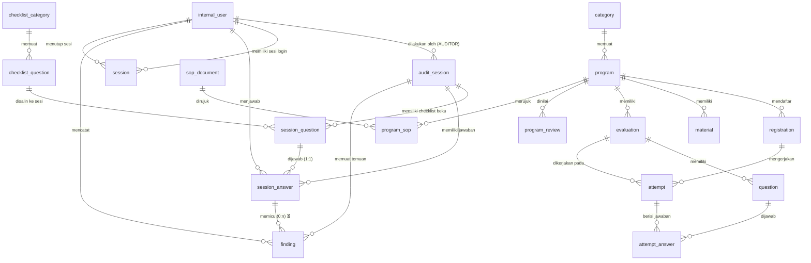

# ERD — Sopinsya (draft awal, 20 Okt 2026)

Status: **draft untuk konfirmasi**. Sumber: RD 2 (modul F-01…F-18) + catatan keputusan meeting (sesi audit, YA/TIDAK, idempotensi). Asumsi teknis ditandai eksplisit; item bertanda ⏳ menunggu konfirmasi (lihat [PROJECT-AUDIT.md](PROJECT-AUDIT.md) §2 C-01…C-09).

Prinsip: hanya entitas yang punya alasan bisnis dari RD 2/keputusan meeting. Tanpa tabel pembayaran/sertifikat (di luar lingkup).

## 1. Diagram (Mermaid)

## 2. Keputusan Cardinality & Constraint

| Relasi | Cardinality | Catatan |
|---|---|---|
| internal_user → audit_session | 1 : n | Auditor (role `AUDITOR`) menjalankan sesi |
| audit_session → session_question | 1 : n | Checklist **disalin (snapshot)** ke sesi saat dibuat → master checklist boleh berubah tanpa mengubah sesi berjalan ⏳ (C-02) |
| session_question → session_answer | 1 : 1 | `UNIQUE(session_question_id)` — menjawab ulang = **update**, tidak menggandakan (idempotensi) |
| session_answer → finding | 1 : n | Satu jawaban boleh punya beberapa temuan (jika bisnis mengizinkan) ⏳ (C-02) |
| audit_session → finding | 1 : n | Temuan selalu terlacak ke sesi, meski `session_answer_id` nullable (temuan tanpa jawaban spesifik) |
| program → registration | 1 : n | Form pendaftaran tanpa login (F-04) |
| evaluation → attempt | 1 : n | ⏳ identitas pengerja (terdaftar via `registration_id` atau nama+email) menunggu E-5 |
| attempt → attempt_answer | 1 : n | `UNIQUE(attempt_id, question_id)` — submit ganda tidak menggandakan jawaban |
| program → material | 1 : n | `url` (tautan eksternal) dan `file_path` (upload) keduanya disediakan sementara ⏳ menunggu E-6 |
| program ↔ program_sop ↔ sop_document | n : n | Admin memilih SOP relevan per program (F-08) |

## 3. Aturan Status (transisi)

**audit_session.status** ⏳ (C-02, catatan meeting — tidak ada di RD 2):
- `ACTIVE` → `CLOSED` oleh Admin/Auditor berwenang.
- Selama `ACTIVE`: checklist pada sesi beku (snapshot `session_question` tidak berubah walau `checklist_question` diedit).
- Setelah `CLOSED`: jawaban & temuan tidak diedit (keputusan final soal "pembukaan kembali temuan" menunggu C-08).

**finding.status** ⏳ (usulan, menunggu C-08): `OPEN` → `CLOSED`. RD 2 hanya mewajibkan "memantau statusnya" (F-15); nilai final disepakati dengan klien.

**finding.category**: `MAJOR | MINOR | OBSERVASI` — persis istilah RD 2 §3.2 (F-15). Pasti.

**session_answer.answer**: `YA | TIDAK` ⏳ (C-02, catatan meeting).

**Idempotensi** (catatan meeting):
- `finding.request_id` UNIQUE — permintaan ulang yang sama tidak menghasilkan temuan ganda.
- `attempt_answer` UNIQUE(attempt_id, question_id) — submit ganda aman.
- `session_answer` UNIQUE(session_question_id) — jawaban ulang = perbarui nilai.

## 4. Entitas yang Sengaja TIDAK dibuat

| Entitas | Alasan |
|---|---|
| `payment` / `certificate` | X-01 — di luar lingkup RD 2 |
| `video_room` / konferensi | X-02 — pakai tautan Zoom/Meet (N-04) |
| `user_peserta` (akun) | C-05 (E-5) belum diputuskan; RD 2: User akses publik tanpa login |
| `chat` / pesan WhatsApp | F-17 hanya tautan |
| `audit_log` sistem | Tidak disebut RD 2 — usulan DEFER |

## 5. Langkah berikutnya

1. Konfirmasi item ⏳ (C-02, C-05, E-4, E-6) bersama klien/tim.
2. Jadikan skema ini `prisma/schema.prisma` (Tahap A fondasi).
3. Hasilkan SQL migrasi; **jalankan hanya pada database development yang sudah diverifikasi** (blocker: MySQL belum tersedia di mesin).
